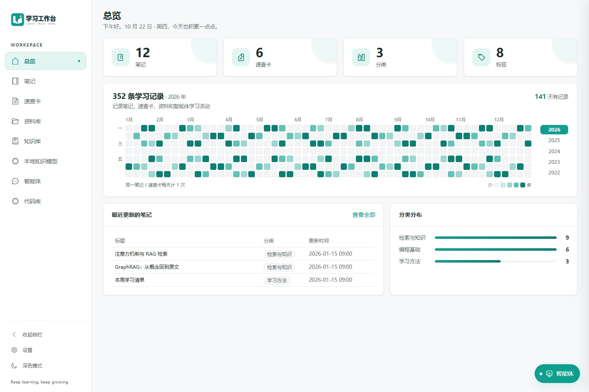
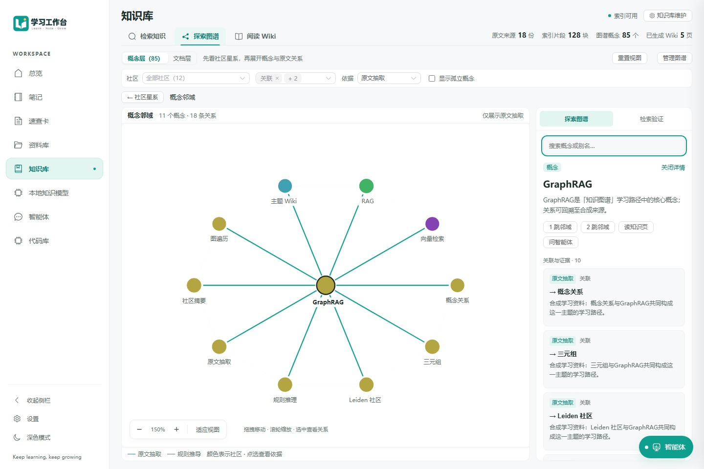
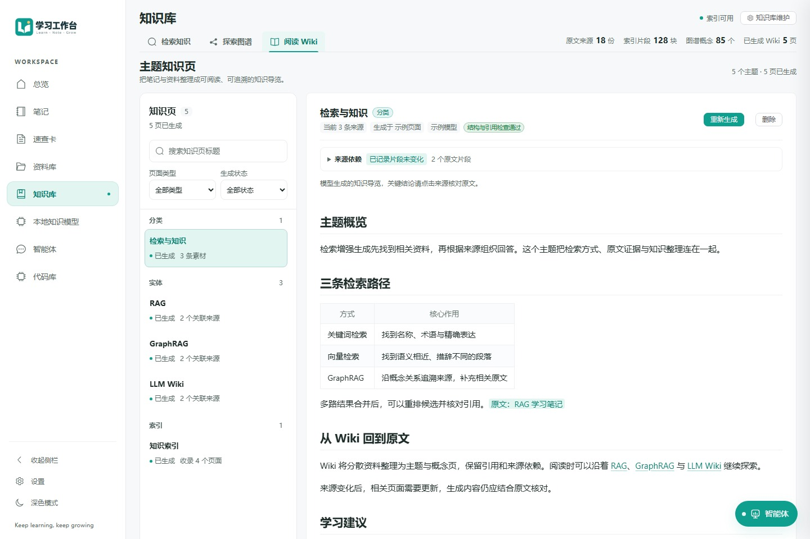

# LearnHub · 学习工作台

LearnHub 将笔记、速查卡、原始资料和智能体放在一个工作台中。通过关键词、向量检索、GraphRAG 和 LLM Wiki，从问题找到原文，也能沿着概念关系继续学习。


## 主要功能

| 模块 | 能做什么 |
| --- | --- |
| 笔记 | 文件夹收纳与批量移动、多笔记标签页、笔记与章节链接，Markdown 与块编辑、目录、表格、LaTeX 公式、导入与导出 |
| 速查卡与分类 | 管理命令和 API 速记，用分类与标签组织内容 |
| 资料库 | 用文件夹收纳 PDF、Word、Excel、PPT 和文本，批量移动，抽取正文并纳入知识检索 |
| 原文阅读 | 阅读 PDF、Word 和 Markdown，划词或选段后对照翻译 |
| 智能体 | 检索知识、阅读来源、创建与修改笔记、导入网络资料，保存会话与摘要；按能力缺口生成、审查和复用自适应工具 |
| 定向编辑 | 定位插入、删除、替换与格式调整，预览改动后确认应用 |
| GraphRAG | 探索概念及其关系，通过有来源的关系补充原文召回，并生成社区摘要 |
| LLM Wiki | 生成主题页、概念页和索引页，通过双链与来源入口组织知识 |
| 学习记录 | 查看学习活动热力图和最近更新 |
| 模型与技能 | 按任务选择模型，编辑技能提示词，支持独立嵌入模型配置 |
| MCP | 让支持 MCP 的客户端访问笔记、速查卡与资料库 |

公式抽取保留原图对照，并支持视觉模型识别与 LaTeX 修正。识别效果取决于文档质量与所选模型，可以在阅读器中核对和修改。

智能体生成回答、笔记和长文时，数学定义、概率、评分、损失、更新规则与推导优先使用 LaTeX 公式，真实程序实现与命令保留代码格式。融入内容和整理格式也遵守这一约定；语言润色保留已有公式与代码，多行公式在分段处理时保持完整。

长文笔记优先按完整大纲一次生成，使用当前对话模型档案的输出上限；只有模型明确报告达到输出上限（`finish_reason=length`）时，才分派子智能体分段生成，由主智能体按大纲顺序合并为一篇，提供单张确认卡片。子任务最多 3 个并行，共用原请求截止时间；未完成的小节会明确标记，若没有完成的小节则保留首次实际生成的未完成正文。一般超时或非 `length` 的空白响应不会触发分段，没有可保留的正文时不生成空白卡片；分段不能保证无限长输出或缺项完整。

智能体遇到工具能力缺口时，可检查项目源码，组合原生工具与数据转换，并编写在独立临时容器内执行的 Python 代码工具。试运行返回实际测试结果和错误诊断；注册前检查能力重复、代码指纹、源码引用及正常/边界测试。优先补齐同名工具，支持停用和重新测试后的版本回退；业务写入仍通过确认预览。代码执行环境为可选 Docker 服务，启用方式与合成示例见 [自适应工具说明](docs/agent-tool-evolution.md)。

联网阅读保持 HTTP 优先，可按需启用 Scrapling 浏览器服务处理需要 JavaScript 的页面；`web_search` 不变。长网页可通过会话内的 `page_id` 分页续读同一份快照，获取模式、缓存时限与可选部署见 [网页获取说明](docs/web-fetching.md)。

智能体对话实时展示检索、工具调用、自适应工具内部步骤、来源核对与耗时；完成后过程自动折叠，可展开或从历史会话回看。切换会话或断开页面后，后台任务仍会继续，稍后重新打开会话可读取结果。写操作的待确认、取消与失败状态会同步显示在过程记录中。

复杂任务支持可更新的工作计划，并在工具返回后继续执行、修正或核对结果；重复调用、无进展和预算耗尽有明确停止边界。计划与实际执行分别展示，待确认和未完成不会被当作任务成功；历史摘要记录准确覆盖范围。机制、预算与参考资料见 [智能体执行循环](docs/agent-loop.md)。

笔记和资料库分别管理文件夹，采用资源管理器式浏览：顶部路径栏支持返回、前进和上一级，当前子文件夹与内容在同一列表中显示，可双击或按 Enter 进入目录。根目录显示顶级文件夹和未收纳内容，“全部笔记／全部资料”入口可查看跨目录内容。支持新建子文件夹、重命名和批量移动，文件夹不参与内容分页或批量选择。在当前文件夹中新建笔记、导入或上传，会自动收纳到该位置。删除没有子文件夹的目录时，内容保留并移到根目录；包含子文件夹时，需要先处理子文件夹。文件夹与分类、标签可配合使用，移动内容不改变正文与检索索引。

打开多篇笔记后，可通过顶部标签页随时切换，编辑中的草稿和光标会保留。点击标签栏的“新建笔记”可独立打开新草稿；关闭未保存的笔记会提示确认。工具栏的“超链接”支持网址、指定笔记及具体章节，可在光标处插入，或为选中文字添加链接。草稿保存在当前页面的编辑器中，刷新或退出前请先保存。

## 界面预览

以下为当前应用使用独立示例数据运行的截图；笔记、记录、数量和模型信息均为演示内容。

**总览：学习记录、最近更新与分类分布。**



| 笔记编辑 | GraphRAG 知识图谱 |
| --- | --- |
|  |  |
| 源码与正文对照，使用格式工具编辑表格与笔记 | 查看概念关系，按社区筛选并探索来源 |

| 融合检索 | LLM Wiki |
| --- | --- |
|  |  |
| 展示召回通道、融合分和原文入口 | 沿主题与概念阅读，查看来源依赖并核对引用 |

## 快速安装

准备 Node.js **22.14+** 和正在运行的 Docker（Docker Compose **2.20+**）。使用已发布的安装包启动：

```bash
npx @luyiyanyumu/learnhub@latest start
```

默认网页入口：[http://localhost:8888](http://localhost:8888)。

```bash
npx @luyiyanyumu/learnhub@latest status
npx @luyiyanyumu/learnhub@latest stop
npx @luyiyanyumu/learnhub@latest update
```

启动器使用已构建的版本镜像，实例配置默认保存在用户目录下的 `~/.learnhub`，数据库、上传资料和技能使用 Docker 具名卷持久化。

- `start` 启动当前已安装版本。
- `update` 获取新版，在更新流程中暂停写入、备份数据并执行数据库迁移。
- 已有源码 Compose 部署通过 `adopt` 接管，具体参数见安装文档。

完整说明：[安装、接管、备份与恢复](docs/npx-install.md) · [启动器命令](cli/README.md) · [发布流程](docs/releases.md)。

## 从源码部署

在仓库根目录执行：

```bash
cd deploy
cp .env.example .env
```

Windows PowerShell 可将复制命令替换为：

```powershell
Copy-Item .env.example .env
```

编辑 `deploy/.env`，设置自己的数据库密码，并按需调整端口、镜像来源和模型配置，然后启动：

```bash
docker compose up -d --build
```

默认访问 [http://localhost:8888](http://localhost:8888)。不配置模型也可以使用笔记、分类、资料管理和关键词检索；智能体、生成 Wiki 与翻译等功能需要相应模型。

Windows 也提供 `start-all.bat`、`stop-all.bat` 和 `update.bat` 作为源码 Compose 操作入口。

部署参数、可选 Ollama 服务和排错方法见 [部署说明](deploy/README.md)。

## 配置模型

启动后进入 **设置 → 模型档案与分工**，添加模型档案并为任务选择模型。聊天、润色、Wiki 生成、翻译等任务可以分别配置；会话也可以选择自己的聊天模型。

向量检索使用独立的**嵌入档案**：

- 支持 Ollama `/api/embed` 和兼容 `/embeddings` 的服务。
- 未配置嵌入档案时，关键词检索仍可使用。
- `bge-m3` 是可选模型，不要求使用特定嵌入服务。
- 更换嵌入服务或模型后，后台自动维护会按向量设置更新语义索引及相关图谱实体向量；不同嵌入空间的旧向量不会混用。
- 仅轮换同一服务、同一模型的 API 密钥无需重建索引。
- 旧环境变量配置可通过“兼容旧嵌入配置”使用；没有嵌入标识的旧索引需要重建。

后端运行在容器中时，模型地址必须能从容器访问。宿主机服务可使用 `host.docker.internal`；同一 Compose 网络中的服务使用服务名。

模型调用和联网工具的数据流向取决于配置的服务。API 密钥保存在部署配置或应用设置中，不应写入项目文档。

## 知识检索如何配合

检索页与智能体共用检索服务。在融合检索中，各通道召回候选原文片段，合并去重后使用 RRF 融合排名，再按配置重排。

进入 **设置 → 知识库**，可调整切块、嵌入批次、向量阈值、候选数量、融合、重排和回答上下文预算。参数按组保存，服务端校验组合约束；切块、上下文嵌入或嵌入输入上限变化后，后台自动维护会排队更新向量索引。面板提供索引状态、模型分工、重建及 Milvus 同步入口。

知识库默认由服务端自动维护：合并原文变更后更新索引、实体与主题 Wiki、概念图谱、文档关联、社区、摘要和自检，进度持久保存，失败自动退避重试。知识库页面的维护抽屉可查看实际步骤、暂停自动维护或立即排队；离开页面后任务继续。单项重建保留在高级修复中。范围与接口见 [知识库后台自动维护](docs/knowledge-maintenance.md)。

同一板块的 **检验区** 提供五个内置合成案例和当前资料检索，显示各阶段耗时与数量、命中原文、重排前后顺序及实际组装的上下文。合成资料只在本次请求内存中使用，不写入资料库；配置有效时会使用真实嵌入、补检索或重排模型。召回率和倒数排名仅对已标注的内置案例计算，未覆盖主题及当前资料不显示虚构的成功率。检验复用正式检索链路，不生成答案。

| 通道 | 分工 |
| --- | --- |
| 关键词检索 | 查找名称、术语、代码及精确表达 |
| 向量检索 | 查找语义接近但措辞不同的原文 |
| GraphRAG 局部证据 | 从概念和直接关系找到相关来源，只使用能与当前原文核对的证据 |
| Wiki 导览 | 匹配 Wiki 小节，沿来源依赖回查当前原文，补充候选与阅读方向 |
| 全局社区摘要 | 为整体性问题补充主题概览，作为独立上下文，不与原文片段混用排名 |

### GraphRAG

图谱把来源中的概念、实体和关系组织起来。局部检索扩展概念的直接关系，用关系证据找回原文；图谱界面支持筛选、聚焦、缩放和来源查看。

全局社区摘要由相关概念及有来源的关系生成，适合回答“有哪些主题”“这些知识如何关联”等问题。来源变化后，相关摘要会被标记为过期并由后台分批更新；检索使用有效的缓存摘要。

### LLM Wiki

Wiki 将分散的资料整理为主题页、概念页和索引页，保留来源依赖、引用片段与双链。它既是阅读入口，也参与检索导览。

来源更新后，受影响的导览会停用，页面显示待更新状态，后台按需重新生成。也可以手动重新生成单页，并通过知识自检发现无效链接、引用问题与内容缺口。

详见 [Wiki 检索设计](docs/wiki-retrieval-2026-10-07.md) 和 [GraphRAG 改进说明](docs/graphrag-improvements-2026-10-07.md)。

## 开发环境

| 组件 | 要求 |
| --- | --- |
| 前端 | Node.js 22.14+、Vue 3、Vite、Element Plus、Tiptap |
| 后端 | JDK 21、Maven 3.9+、Spring Boot、MyBatis-Plus |
| 数据库 | MySQL 8，数据库结构由 Flyway 管理 |
| 部署 | Docker 与 Docker Compose 2.20+ |

先按源码部署步骤准备 `deploy/.env`，启动数据库：

```bash
cd deploy
docker compose up -d mysql
```

在另一个 PowerShell 终端，从仓库根目录启动后端：

```powershell
cd backend
$env:SPRING_DATASOURCE_PASSWORD = '替换为 deploy/.env 中设置的数据库密码'
mvn -DskipTests package
java -jar target/learn-hub-backend-0.0.1-SNAPSHOT.jar
```

默认数据库地址为 `localhost:3307/learn_hub`。如果修改了数据库端口、库名或用户，还需同步设置 `SPRING_DATASOURCE_URL`、`SPRING_DATASOURCE_USERNAME`。

另开终端启动前端：

```bash
cd frontend
npm ci
npm run dev
```

| 入口 | 默认端口 |
| --- | --- |
| Compose / npx 网页 | 8888 |
| Vite 开发页面 | 5174 |
| Vite 构建预览 | 4174 |
| 后端 API | 18080 |
| MySQL 宿主机映射 | 3307 |

开发页面默认将 `/api` 代理到 `http://localhost:18080`。如果修改后端端口，同步调整 `frontend/vite.config.js`。

### 构建与验证

在仓库根目录执行：

```bash
mvn -B -f backend/pom.xml verify
npm --prefix frontend ci
npm --prefix frontend run build
npm --prefix cli test
```

前端工具函数测试见 [前端说明](frontend/README.md)。数据库迁移集成测试需要额外启用 Testcontainers，见 [数据库迁移说明](docs/database-migrations.md)。

## 数据与更新

- Docker 具名卷保存数据库和上传资料；发布版还持久化技能。
- 普通停止与重建容器保留数据。删除数据卷会清除其中的数据。
- 数据库由 Flyway 在启动时迁移，无需手动重复导入 `schema.sql` 或 `data.sql`。
- 更新前备份数据库、上传资料、技能和实例配置。备份与恢复应使用同一部署方式对应的流程。
- 修改来源内容后，后台自动维护语义索引、图谱与受影响的 Wiki；生成内容保留来源核对入口。

具体操作见 [部署维护](deploy/README.md)、[安装器备份与恢复](docs/npx-install.md) 和 [数据库迁移](docs/database-migrations.md)。

## 项目结构

```text
backend/       Spring Boot API、智能体、检索与数据库迁移
frontend/      Vue 页面、编辑器与资料阅读器
deploy/        Compose 配置、反向代理与部署入口
cli/           npx 安装、更新与备份启动器
mcp/           MCP 服务与客户端接入说明
skills/        可编辑的技能提示词
docs/          功能、架构与维护文档
tools/         开发与维护工具
```

## 更多文档

- [原文阅读与翻译](docs/reader.md)
- [笔记定向编辑](docs/note-edit-tool.md)
- [智能体会话与记忆](docs/agent-memory-design.md)
- [网页获取与分页续读](docs/web-fetching.md)
- [学习活动记录](docs/learning-activity.md)
- [PDF 正文排版](docs/pdf-layout-design.md)
- [技能目录与提示词](skills/README.md)
- [MCP 接入](mcp/README.md)
- [前端开发](frontend/README.md)
- [固定知识库评测工具](tools/README.md)

## 许可证

使用 [PolyForm Noncommercial 1.0.0](LICENSE) 许可证。非商业使用与分发应遵守许可证条款；商业使用需另行获得授权。

© 2026 dyh
