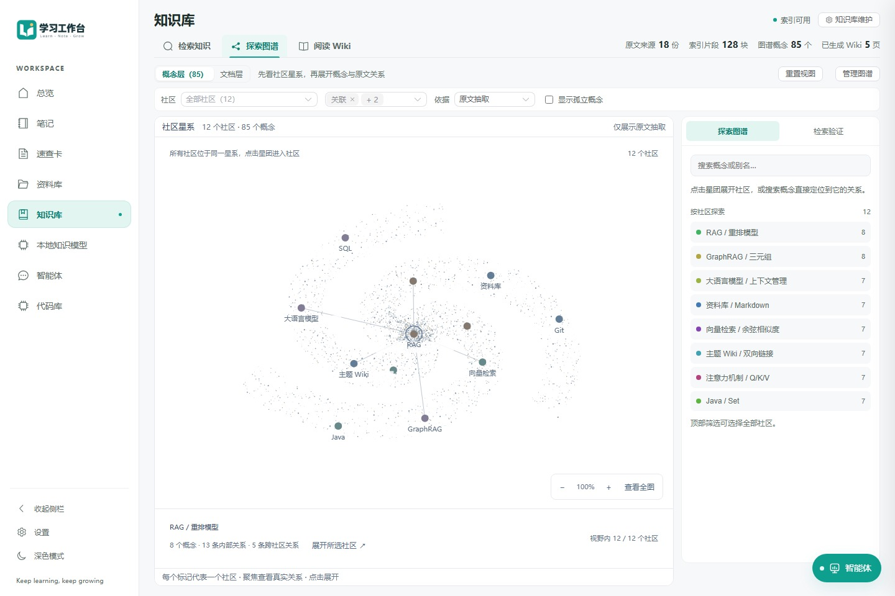
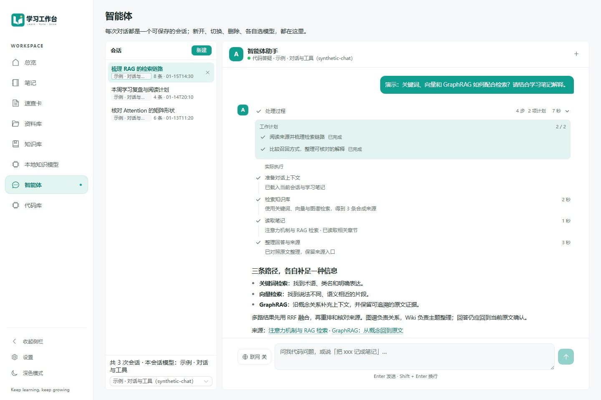
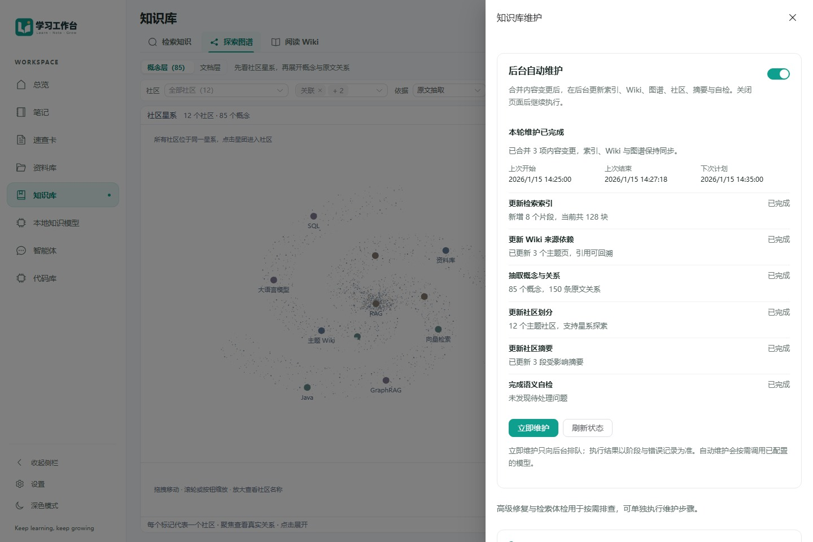

# LearnHub · 学习工作台

LearnHub 是一个可自托管的学习与知识工作台，将笔记、速查卡、原始资料、代码片段和智能体放在一起。用关键词与向量检索找到原文，用社区星图、GraphRAG 和 LLM Wiki 梳理关系，再把核对后的结论写回笔记。


当前版本：[LearnHub 0.1.6](docs/release-notes/0.1.6.md) · [Windows 启动器 1.1.0](launcher/README.md)。

[界面预览](#界面预览) · [快速安装](#快速安装) · [配置模型](#配置模型) · [源码部署](#从源码部署) · [开发环境](#开发环境) · [更多文档](#更多文档)



*社区星图 → 展开社区 → 核对概念与原文。上图使用合成演示数据。*

## 主要功能

| 模块 | 能做什么 |
| --- | --- |
| 笔记工作区 | 多笔记标签页、Markdown 与块编辑、目录和章节链接；切换保留草稿、光标与撤销历史 |
| 表格与公式 | 编辑表格、渲染 LaTeX 和表格内公式，支持富文本粘贴、导入与导出 |
| 文件夹与资料 | 以路径栏和同一列表浏览子文件夹与内容，批量收纳笔记、PDF、Word、Excel、PPT 和文本 |
| 原文阅读 | 阅读 PDF、Word 和 Markdown，查看抽取结果，划词或选段后对照翻译 |
| 融合检索 | 合并关键词、向量、图谱和 Wiki 导览候选，展示通道与原文入口，支持重排 |
| 知识分块 | 按标题、段落和完整结构分块，保护公式、代码与表格；长资料可选语义切割，复用持久化分块并补齐相关原文 |
| 社区星图与 GraphRAG | 先浏览知识社区，再展开概念关系与邻域，沿有来源的关系回到证据 |
| LLM Wiki | 整理主题页、概念页和索引页，通过双链、引用和来源依赖继续阅读 |
| 智能体 | 管理独立会话与模型，查看计划、工具调用和耗时；按任务生成操作选项，笔记改动前自动保存，多处补写分批生成后统一预览确认 |
| 后台自动维护 | 默认开启，来源或配置变化后按需更新索引、Wiki、图谱与社区，查看实际步骤、进度和重试状态 |
| 代码库 | 按项目与语言组织片段，通过 Agentic Search 多轮搜索、读取代码并返回行号依据 |
| 速查卡与学习记录 | 用分类、标签整理命令和 API，查看学习热力图及最近更新 |
| 模型、技能与 MCP | 按任务选择模型、独立配置嵌入档案、编辑技能提示词，让 MCP 客户端访问学习资料 |

日常使用可以从四步开始：**收纳资料 → 检索并核对原文 → 探索社区与 Wiki → 整理成笔记或速查卡**。没有配置模型时，也可以先使用笔记、分类、资料管理与关键词检索。

笔记和资料库各自管理文件夹，顶部路径栏提供返回、前进和上一级；子文件夹与内容在同一列表中显示，另有跨目录的“全部”入口。多篇笔记可同时打开，切换时保留编辑状态，链接可以指向另一篇笔记或具体章节。草稿保存在当前页面中，刷新或退出前请先保存。

界面随窗口尺寸与浏览器缩放重排。分屏时保留右侧大纲，更窄时通过顶栏“大纲”按钮打开抽屉；保存、筛选、分页与弹窗操作可通过换行或滚动到达。

智能体执行过程与历史会话都可回看；切换会话或离开页面后，已开始的本轮任务在执行预算内继续。它可以检索、读取来源、导入网页、定向修改笔记，并按需生成和复用自适应工具；写操作以确认预览为准，待确认或未完成的步骤不会显示为成功。执行边界与可选代码运行环境见 [智能体执行循环](docs/agent-loop.md)、[会话与记忆](docs/agent-memory-design.md) 和 [自适应工具](docs/agent-tool-evolution.md)。

生成提示词要求数学回答、笔记、内容融入和格式整理使用 LaTeX 表达数学定义与推导，真实程序和命令保留代码。长文优先按完整大纲整篇生成，只有模型明确报告达到输出上限（`finish_reason=length`）时，才启用最多 3 个并行子智能体分节生成，合并为一张确认卡片；多行公式保持完整，未完成的小节会标记。PDF 公式提供原图对照、视觉识别与 LaTeX 修正，识别结果可在阅读器中核对。

联网阅读优先使用 HTTP，需要执行 JavaScript 的页面可选配 Scrapling 浏览器服务。长网页支持在同一会话中分页续读快照，详见 [网页获取](docs/web-fetching.md)。另有默认关闭、需单独部署的 [本地知识模型验证版](docs/knowledge-model.md)，用于实验参数知识训练与闭卷评测。

## 界面预览

以下截图由当前应用使用独立合成数据运行生成；笔记、资料、关系、数量、维护进度与智能体回答均为演示内容，不代表真实知识库或模型效果。

**笔记工作区：多标签切换，在正文中直接编辑表格，渲染表格内外的 LaTeX 公式。**


<details>
<summary>查看更多界面：融合检索、Wiki、概念图、智能体、后台维护与学习总览</summary>

**融合检索：查看召回通道、命中片段与原文入口。**


**LLM Wiki：沿主题和双链阅读，检查引用及来源依赖。**


**展开社区：查看具体概念关系，聚焦邻域并回到来源。**


**智能体：实时查看工作计划、工具调用与回答依据，保留独立会话。**



**后台自动维护：查看索引、Wiki、图谱与社区的实际维护步骤。**



**学习总览：学习热力图、最近更新与分类分布。**


</details>

## 快速安装

准备 Node.js **22.14+** 和正在运行的 Docker（Docker Compose **2.20+**）。使用已发布的安装包启动：

```bash
npx @luyiyanyumu/learnhub@latest start
```

默认网页入口：[http://localhost:8888](http://localhost:8888)。

```bash
npx @luyiyanyumu/learnhub@latest status
npx @luyiyanyumu/learnhub@latest stop
npx @luyiyanyumu/learnhub@latest update
```

启动器使用已构建的版本镜像，实例配置默认保存在用户目录下的 `~/.learnhub`，数据库、上传资料和技能使用 Docker 具名卷持久化。

- `start` 启动当前已安装版本。
- `update` 获取新版，在更新流程中暂停写入、备份数据并执行数据库迁移。
- 已有源码 Compose 部署通过 `adopt` 接管，具体参数见安装文档。

完整说明：[安装、接管、备份与恢复](docs/npx-install.md) · [启动器命令](cli/README.md) · [发布流程](docs/releases.md)。

## 从源码部署

在仓库根目录执行：

```bash
cd deploy
cp .env.example .env
```

Windows PowerShell 可将复制命令替换为：

```powershell
Copy-Item .env.example .env
```

编辑 `deploy/.env`，设置自己的数据库密码，并按需调整端口、镜像来源和模型配置，然后启动：

```bash
docker compose up -d --build
```

默认访问 [http://localhost:8888](http://localhost:8888)。不配置模型也可以使用笔记、分类、资料管理和关键词检索；智能体、生成 Wiki 与翻译等功能需要相应模型。

Windows 可使用 [LearnHub.exe 图形启动器](launcher/README.md) 管理源码项目：检测 Docker、容器和前后端健康，单独重启服务、查看日志并导出脱敏诊断。将 EXE 放在项目根目录，或打开后选择项目目录；窗口跟随系统主题与屏幕缩放。构建 EXE 使用 `./tools/build-launcher.ps1`，源码更新仍使用 `update.bat`。

部署参数、可选 Ollama 服务和排错方法见 [部署说明](deploy/README.md)。

## 配置模型

启动后进入 **设置 → 模型档案与分工**，添加模型档案并为任务选择模型。聊天、润色、Wiki 生成、翻译等任务可以分别配置；会话也可以选择自己的聊天模型。

向量检索使用独立的**嵌入档案**：

- 支持 Ollama `/api/embed` 和兼容 `/embeddings` 的服务。
- 未配置嵌入档案时，关键词检索仍可使用。
- `bge-m3` 是可选模型，不要求使用特定嵌入服务。
- 更换嵌入服务或模型后，后台自动维护会按向量设置更新语义索引及相关图谱实体向量；不同嵌入空间的旧向量不会混用。
- 仅轮换同一服务、同一模型的 API 密钥无需重建索引。
- 旧环境变量配置可通过“兼容旧嵌入配置”使用；没有嵌入标识的旧索引需要重建。

后端运行在容器中时，模型地址必须能从容器访问。宿主机服务可使用 `host.docker.internal`；同一 Compose 网络中的服务使用服务名。

模型调用和联网工具的数据流向取决于配置的服务。API 密钥保存在部署配置或应用设置中，不应写入项目文档。

## 知识检索如何配合

检索页与智能体共用检索服务。在融合检索中，各通道召回候选原文片段，合并去重后使用 RRF 融合排名，再按配置重排。

进入 **设置 → 知识库**，可调整切块、嵌入批次、向量阈值、候选数量、融合、重排和回答上下文预算。参数按组保存，服务端校验组合约束；切块、上下文嵌入或嵌入输入上限变化后，后台自动维护会排队更新向量索引。面板提供索引状态、模型分工、重建及 Milvus 同步入口。

知识库默认由服务端自动维护：合并原文变更后更新索引、实体与主题 Wiki、概念图谱、文档关联、社区、摘要和自检，进度持久保存，失败自动退避重试。知识库页面的维护抽屉可查看实际步骤、暂停自动维护或立即排队；离开页面后任务继续。单项重建保留在高级修复中。范围与接口见 [知识库后台自动维护](docs/knowledge-maintenance.md)。

同一板块的 **检验区** 提供五个内置合成案例和当前资料检索，显示各阶段耗时与数量、命中原文、重排前后顺序及实际组装的上下文。合成资料只在本次请求内存中使用，不写入资料库；配置有效时会使用真实嵌入、补检索或重排模型。召回率和倒数排名仅对已标注的内置案例计算，未覆盖主题及当前资料不显示虚构的成功率。检验复用正式检索链路，不生成答案。

| 通道 | 分工 |
| --- | --- |
| 关键词检索 | 查找名称、术语、代码及精确表达 |
| 向量检索 | 查找语义接近但措辞不同的原文 |
| GraphRAG 局部证据 | 从概念和直接关系找到相关来源，只使用能与当前原文核对的证据 |
| Wiki 导览 | 匹配 Wiki 小节，沿来源依赖回查当前原文，补充候选与阅读方向 |
| 全局社区摘要 | 为整体性问题补充主题概览，作为独立上下文，不与原文片段混用排名 |

### GraphRAG

图谱默认以社区星图展示知识分布与社区之间的联系。点击一个星团或通过键盘选中后展开，可进入社区内部查看具体概念及关联邻域，再返回星图继续浏览。界面支持拖拽、缩放、筛选、概念聚焦与来源查看。

局部检索扩展概念的直接关系，用关系证据找回原文；社区总览与具体概念分别展示，便于先找到学习方向，再核对相关资料。

全局社区摘要由相关概念及有来源的关系生成，适合回答“有哪些主题”“这些知识如何关联”等问题。来源变化后，相关摘要会被标记为过期并由后台分批更新；检索使用有效的缓存摘要。

### LLM Wiki

Wiki 将分散的资料整理为主题页、概念页和索引页，保留来源依赖、引用片段与双链。它既是阅读入口，也参与检索导览。

来源更新后，受影响的导览会停用，页面显示待更新状态，后台按需重新生成。也可以手动重新生成单页，并通过知识自检发现无效链接、引用问题与内容缺口。

详见 [Wiki 检索设计](docs/wiki-retrieval-2026-10-07.md) 和 [GraphRAG 改进说明](docs/graphrag-improvements-2026-10-07.md)。

## 开发环境

| 组件 | 要求 |
| --- | --- |
| 前端 | Node.js 22.14+、Vue 3、Vite、Element Plus、Tiptap |
| 后端 | JDK 21、Maven 3.9+、Spring Boot、MyBatis-Plus |
| 数据库 | MySQL 8，数据库结构由 Flyway 管理 |
| 部署 | Docker 与 Docker Compose 2.20+ |

先按源码部署步骤准备 `deploy/.env`，启动数据库：

```bash
cd deploy
docker compose up -d mysql
```

在另一个 PowerShell 终端，从仓库根目录启动后端：

```powershell
cd backend
$env:SPRING_DATASOURCE_PASSWORD = '替换为 deploy/.env 中设置的数据库密码'
mvn -DskipTests package
java -jar target/learn-hub-backend-0.0.1-SNAPSHOT.jar
```

默认数据库地址为 `localhost:3307/learn_hub`。如果修改了数据库端口、库名或用户，还需同步设置 `SPRING_DATASOURCE_URL`、`SPRING_DATASOURCE_USERNAME`。

另开终端启动前端：

```bash
cd frontend
npm ci
npm run dev
```

| 入口 | 默认端口 |
| --- | --- |
| Compose / npx 网页 | 8888 |
| Vite 开发页面 | 5174 |
| Vite 构建预览 | 4174 |
| 后端 API | 18080 |
| MySQL 宿主机映射 | 3307 |

开发页面默认将 `/api` 代理到 `http://localhost:18080`。如果修改后端端口，同步调整 `frontend/vite.config.js`。

### 构建与验证

在仓库根目录执行：

```bash
mvn -B -f backend/pom.xml verify
npm --prefix frontend ci
npm --prefix frontend run build
npm --prefix cli test
```

前端工具函数测试见 [前端说明](frontend/README.md)。数据库迁移集成测试需要额外启用 Testcontainers，见 [数据库迁移说明](docs/database-migrations.md)。

## 数据与更新

- Docker 具名卷保存数据库和上传资料；发布版还持久化技能。
- 普通停止与重建容器保留数据。删除数据卷会清除其中的数据。
- 数据库由 Flyway 在启动时迁移，无需手动重复导入 `schema.sql` 或 `data.sql`。
- 更新前备份数据库、上传资料、技能和实例配置。备份与恢复应使用同一部署方式对应的流程。
- 修改来源内容后，后台自动维护语义索引、图谱与受影响的 Wiki；生成内容保留来源核对入口。

具体操作见 [部署维护](deploy/README.md)、[安装器备份与恢复](docs/npx-install.md) 和 [数据库迁移](docs/database-migrations.md)。

## 项目结构

```text
backend/       Spring Boot API、智能体、知识维护、检索与数据库迁移
frontend/      Vue 页面、笔记编辑器、社区星图与资料阅读器
deploy/        Compose 配置、反向代理与部署入口
cli/           npx 安装、更新与备份启动器
launcher/      Windows EXE 启动器、服务健康检查与诊断界面
mcp/           MCP 服务与客户端接入说明
skills/        可编辑的技能提示词
docs/          功能、架构与维护文档
tools/         开发与维护工具
```

## 更多文档

- [原文阅读与翻译](docs/reader.md)
- [笔记定向编辑](docs/note-edit-tool.md)
- [知识库后台自动维护](docs/knowledge-maintenance.md)
- [智能体执行循环与预算](docs/agent-loop.md)
- [智能体会话与记忆](docs/agent-memory-design.md)
- [自适应工具与可选代码运行环境](docs/agent-tool-evolution.md)
- [代码库 Agentic Search](docs/code-agentic-search.md)
- [本地知识模型验证版（实验）](docs/knowledge-model.md)
- [网页获取与分页续读](docs/web-fetching.md)
- [学习活动记录](docs/learning-activity.md)
- [PDF 正文排版](docs/pdf-layout-design.md)
- [技能目录与提示词](skills/README.md)
- [MCP 接入](mcp/README.md)
- [前端开发](frontend/README.md)
- [固定知识库评测工具](tools/README.md)

## 许可证

使用 [PolyForm Noncommercial 1.0.0](LICENSE) 许可证。非商业使用与分发应遵守许可证条款；商业使用需另行获得授权。

© 2026 dyh
