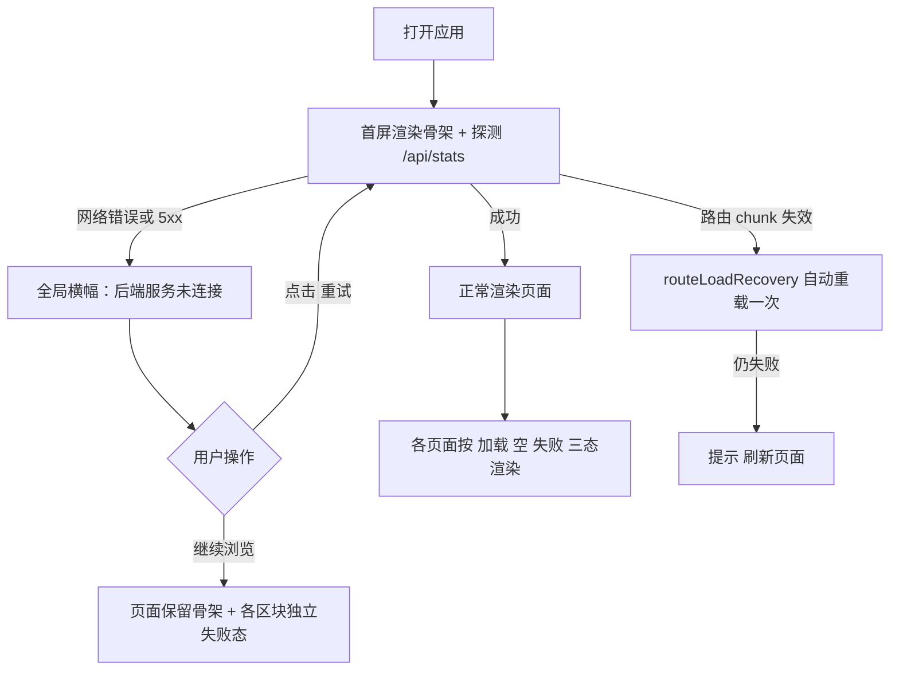
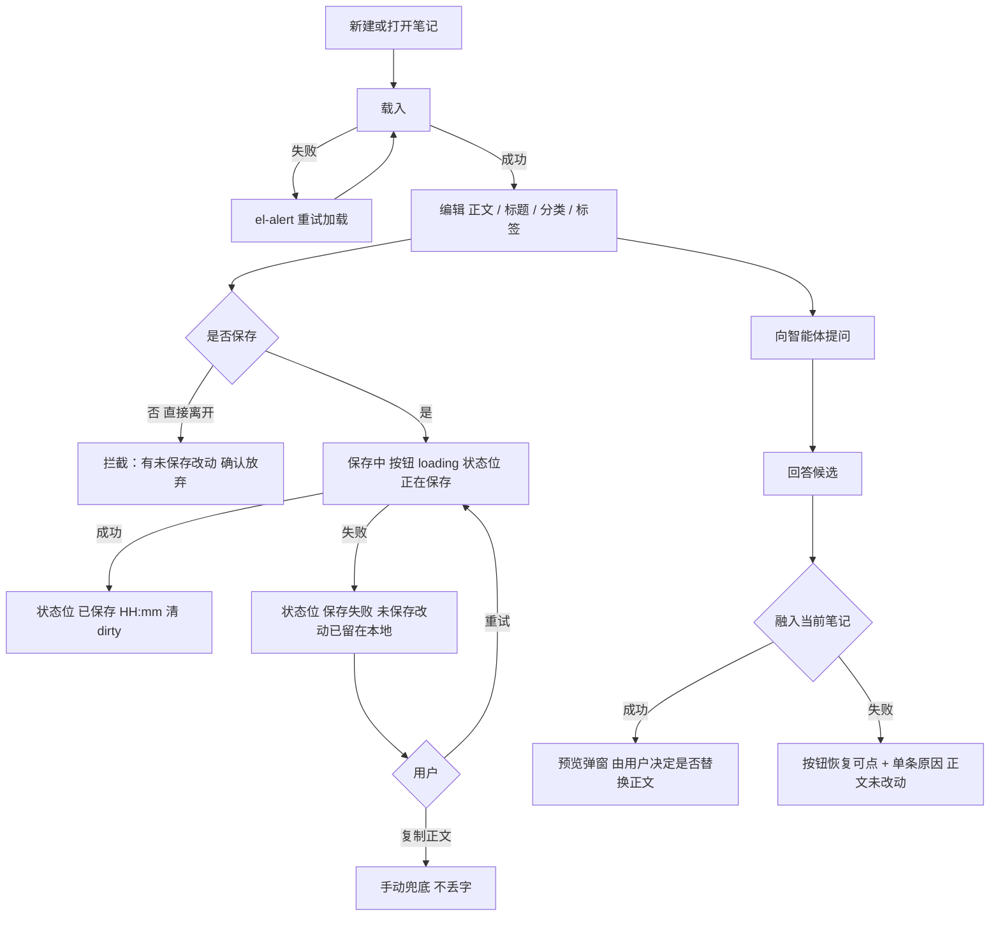
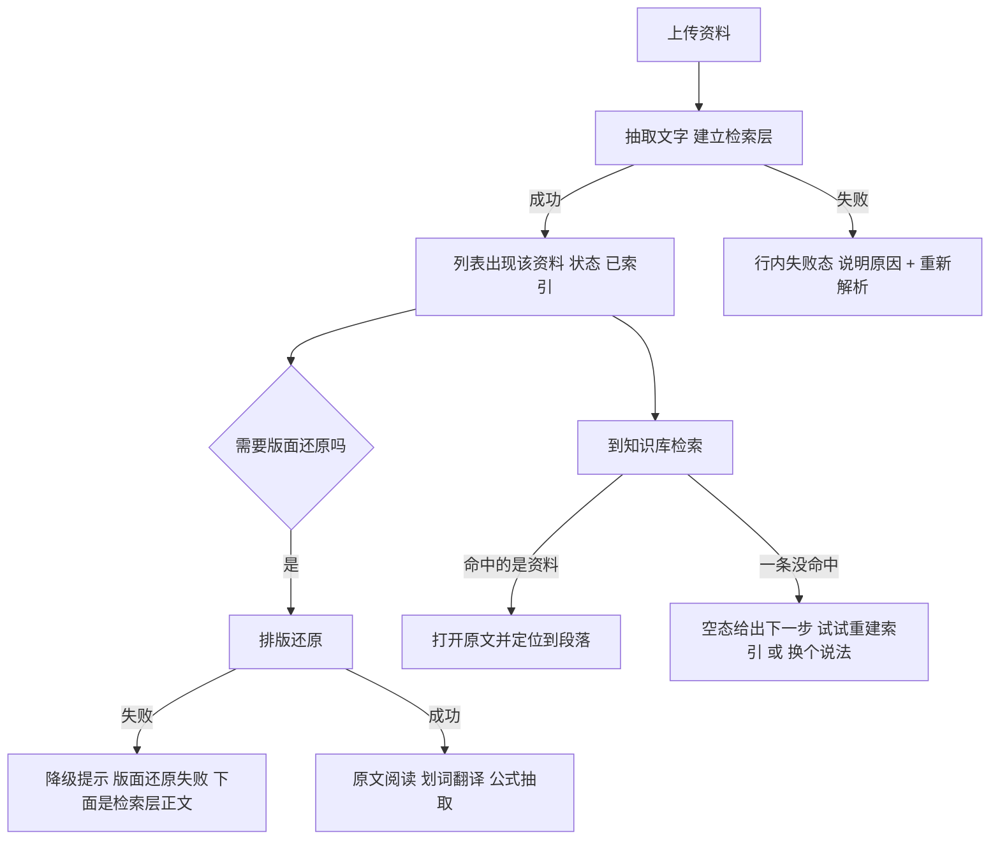
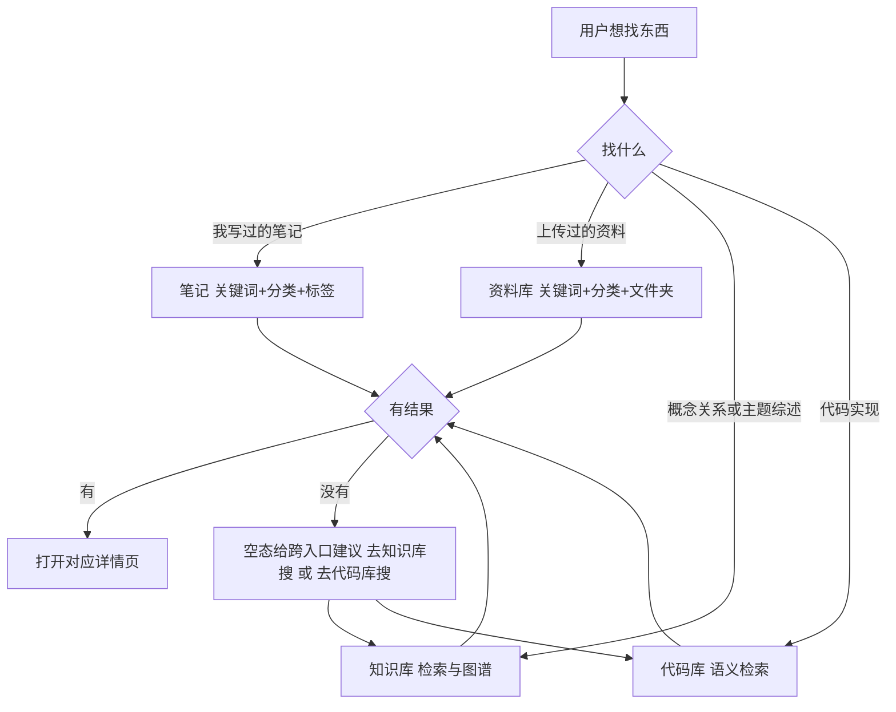
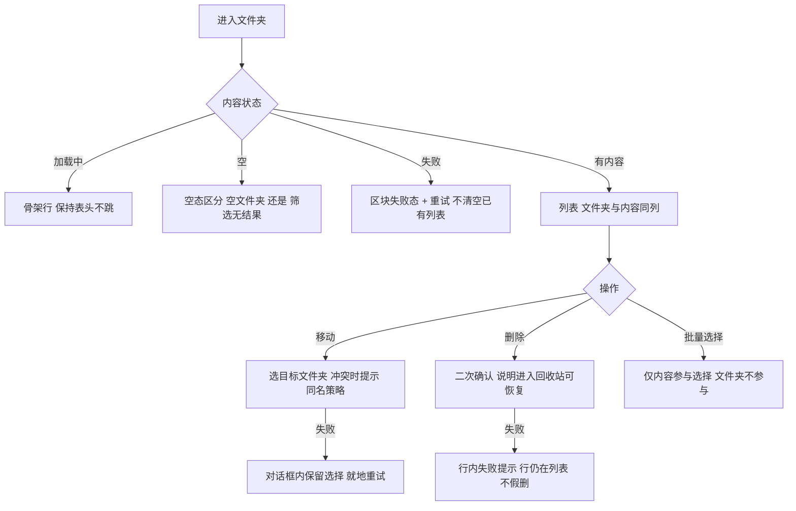

# 前端界面优化方案（UI 与流程 · 2026-10-10）

范围：`frontend/`（Vue 3 + Vite + Element Plus）。本文只出**方案与规范**，不改代码；落地由实现节点按第 7 节分期执行。
所有结论都带 `文件:行` 证据，可直接跳过去核对。

---

## 0. 一页结论

**能优化的不是「好不好看」，是「三态（加载 / 空数据 / 失败）不统一」和「核心流程缺路标」。**

设计系统本身已经很成熟——青绿品牌色、语义 token、浅深双主题、字号/间距/圆角阶梯在 `frontend/src/style.css:14-120` 里都收口了，视觉层面不需要重做。真正的问题在**状态表达**：

| 缺口 | 事实 | 证据 |
| --- | --- | --- |
| 4 个页面**没有失败态**，请求挂了会渲染成"空数据"文案 | 笔记列表、速查卡、智能体会话列表、总览统计 | `views/NoteList.vue:152-170`、`views/QuickRefs.vue:99-110`、`views/AgentSessions.vue:48-50`、`views/Dashboard.vue:48-55` |
| 同一页内两种口径 | 总览「学习记录」有失败态+重试，旁边「统计卡」没有 | `views/Dashboard.vue:57-69` vs `views/Dashboard.vue:48-55`；`components/ActivityHeatmap.vue:50-53` |
| 空态 **8 种写法** | `el-empty` 4 处 + 自定义 `.hint.empty` / `.empty-card` / `.side-empty` / `.chat-empty` / `.probe-empty` | `views/QuickRefs.vue:216`、`views/CodeLibrary.vue:527,634`、`views/AgentSessions.vue:186,218`、`views/Knowledge.vue:1350` |
| 加载态 **4 种写法** | 整块 `v-loading`、骨架屏、内联 `role="status"` 提示、把加载文案塞进空态变量 | `views/FileLibrary.vue:613`、`components/KnowledgeSearchPanel.vue:105`、`views/CodeLibrary.vue:576`、`views/AgentSessions.vue:31` |
| 失败态只有 2 处给了**重试** | 笔记编辑加载失败、知识检索失败 | `views/NoteEdit.vue:3693-3695`、`components/KnowledgeSearchPanel.vue:96-101` |
| 没有**全局**降级 | 后端没起来的唯一反馈是一条 toast，页面照旧渲染空态 | `api/index.js:9-30` |
| 保存失败**没有状态位** | `save()` 是 try/finally 无 catch；顶部状态只有 saving/saved/dirty 三档 | `views/NoteEdit.vue:1017-1071`、`views/NoteEdit.vue:3237-3245` |
| 响应式**断点 13 种** | 480/560/600/640/680/720/760/800/860/980/1050/1100/1600 各处随手写 | `grep -rn "@media" frontend/src` |

**优先级建议**：P0 = 补齐失败态 + 抽一个共用的三态组件 + 全局离线降级（让"坏了"一眼可辨）；P1 = 空态/加载态统一 + 断点收敛到 3 档 + 首次使用引导；P2 = 骨架屏推广、键盘/无障碍、保存失败状态位。

---

## 1. 现状盘点

### 1.1 技术基线（这些不用动）

- 品牌与 token：`frontend/src/style.css:14-120`（`--app-*` 语义色、`--font-*` 字号阶梯、`--space-*` 间距、`--radius*`、`--ease/--dur-*`）。
- 主题：`frontend/src/composables/useTheme.js` + `initTheme()` 在挂载前执行（`frontend/src/main.js:35`）。
- 组件按需引入：`frontend/src/main.js:13-19`（首屏 CSS 438.9 KB → 131.4 KB 的既有成果，别回退成全量引入）。
- 布局与导航：`frontend/src/layout/AppLayout.vue:57-66`（7 个一级导航，最长前缀匹配高亮，见 `:39-53`）。
- 窄屏侧栏：`680px` 以下自动折叠为图标栏（`layout/AppLayout.vue:70-73`）。
- 路由级容错已有：chunk 加载失败恢复（`frontend/src/router/index.js:26-39`、`utils/routeLoadRecovery.js:9-40`）。
- 已有无障碍基础：`aria-busy` / `role="status"` / `role="alert"` 合计 23 处（如 `components/KnowledgeSearchPanel.vue:76,94`、`components/ActivityHeatmap.vue:50`）。

### 1.2 状态覆盖矩阵（现状）

图例：✅ 完整 · ⚠️ 有但口径不一 · ❌ 缺失

| 页面 | 加载 | 空数据 | 失败 | 重试 | 证据 |
| --- | --- | --- | --- | --- | --- |
| 总览 `/` | ✅ 整页 `v-loading` | ✅ `el-empty`×2 | ⚠️ 仅热力图 | ⚠️ 仅热力图 | `views/Dashboard.vue:111,176,192`；失败态 `:57-69` vs 无失败态 `:48-55` |
| 笔记列表 `/notes` | ✅ | ✅ 区分筛选/空白 | ❌ 失败→空态文案 | ❌ | `views/NoteList.vue:314,446`；`load()` `:152-170` 无 catch |
| 笔记编辑 `/notes/:id` | ✅ | —（新建即空文档） | ✅ `el-alert` | ✅「重试加载」 | `views/NoteEdit.vue:3692,3693-3695,943` |
| 笔记保存 | ⚠️ 只有「正在保存…」 | — | ❌ 无失败状态位 | ⚠️ 需手动再点保存 | `views/NoteEdit.vue:1017-1071`、`:3237-3245` |
| 速查卡 `/refs` | ✅ | ✅ 固定文案 | ❌ | ❌ | `views/QuickRefs.vue:215,216`；`load()` `:99-110` 无 catch |
| 资料库 `/files` | ✅ | ✅ 三档语境文案 | ⚠️ 仅阅读器 | ⚠️ | `views/FileLibrary.vue:53-55,613,710,828,831-834` |
| 知识库 `/knowledge` | ✅ 含骨架屏 | ✅ 语境化 | ✅ 最好的一页 | ✅ 且可切检索方式 | `views/Knowledge.vue:1267,1377,1269,1516`；`components/KnowledgeSearchPanel.vue:82,96-105` |
| 智能体 `/agent` | ✅ | ⚠️ 自定义 `.hint` | ❌ 吞错→空态 | ❌ | `views/AgentSessions.vue:169,186,218`；`:48-50` |
| 代码库 `/code` | ✅ | ⚠️ 自定义 `.hint` | ⚠️ `el-alert` 无动作 | ❌ | `views/CodeLibrary.vue:604,639,527,634,577,644` |

### 1.3 缺口清单

**P0（影响"能不能用/看不看得懂"）**

1. `views/NoteList.vue:152-170` `load()` 是 `try/finally`，无 `catch`：请求失败时只有 axios 拦截器的 toast（`api/index.js:20-30`），列表保持旧数据或为空，随后 `views/NoteList.vue:446` 渲染"这里还没有内容，可以新建文件夹、笔记或导入已有笔记"——**把故障说成了没有数据**。
2. `views/QuickRefs.vue:99-110` 同上，失败后显示"还没有速查卡，点右上角添加一张"（`:216`）。
3. `views/AgentSessions.vue:48-50` `catch { sessions.value = [] }`：读取会话失败被静默转成"空"，右侧提示"新建一个会话"（`:31`、`:218-221`），用户会以为历史会话丢了。
4. `views/Dashboard.vue:48-55` 统计请求无失败分支，卡片会显示 0；同页热力图却有完整失败态+「重新加载」（`components/ActivityHeatmap.vue:50-53`）。
5. 无全局降级：后端不可达时 7 个页面各自弹 toast（`api/index.js:20-30`），没有任何一处告诉用户"服务没起来，重试"。
6. 保存失败无状态位：`views/NoteEdit.vue:1017-1071` 无 `catch`，失败只留一条 toast，顶部 `saveState`（`:3237-3245`）仍回到"未保存"，与"我明明点过保存"的直觉冲突。

**P1（一致性 / 首次体验）**

7. 空态 8 种写法、加载态 4 种写法，"空"和"加载中"甚至共用同一变量（`views/AgentSessions.vue:31`）。
8. 失败文案两极：有的只说结论（`components/ActivityHeatmap.vue:51`"学习记录暂时加载失败"），有的把后端原话直接抛出（`views/CodeLibrary.vue:577` `:title="searchError"`）。缺统一的「什么失败 + 影响什么 + 下一步」结构。
9. 断点 13 种（见 §0 表），窄屏行为靠各自实现，`680px`（AppLayout）与 `760px`（Knowledge）之间会出现"侧栏已折叠但内容还没重排"的夹缝。
10. 无首次使用引导：`docs`/`README.md:31` 的截图是唯一说明书；空库状态下 4 个页面只给一句"还没有…"。

**P2（打磨）**

11. 骨架屏只在知识检索用了一处（`components/KnowledgeSearchPanel.vue:105`），其余首屏是整块 `v-loading` 遮罩。
12. 键盘/焦点：`focus-visible` 样式只覆盖侧栏与少数按钮（`layout/AppLayout.vue:196-199`）；自定义空态`<p>`不可聚焦，`role="status"` 覆盖不全。
13. `prefers-reduced-motion` 只在 3 处生效（见 `grep "@media (prefers-reduced-motion" frontend/src`），`--dur-*` 动画（`style.css:110-116`）没有全局降级。

---

## 2. 核心流程（流程图）

### 2.1 冷启动：建立"后端是否可用"的认知

当前：任何接口失败都只是 toast，用户不知道是"没有数据"还是"服务没起来"。
目标：**一次探测 + 全局横幅**，页面级失败态负责局部，全局横幅负责"整条链路断了"。



### 2.2 写笔记主流程（含保存失败与智能体融入）

当前：保存失败无状态位（`views/NoteEdit.vue:1017-1071`）；融入失败已处理得不错（`components/AgentPanel.vue:497-502`）。
目标：把"保存"做成**可回滚、可重试、状态可见**的一步。



### 2.3 资料入库 → 被检索到

当前：上传（`views/FileLibrary.vue:263-272`）、版面还原失败降级成"检索层正文"（`:326-328,831-834`）已经做了；缺口是**上传后的下一步没有路标**。



### 2.4 找东西：同一意图的 4 个入口如何选

当前：7 个一级导航（`frontend/src/layout/AppLayout.vue:57-66`）没有任何"我该去哪个页面"的引导，知识检索、代码库检索、笔记筛选、资料库筛选是四套独立搜索框。
目标：**每个空态/搜索空结果里给出跨页跳转**（知识库已有的做法可以推广，见 `views/Knowledge.vue:1354` 的"转到正文检索 →"）。



### 2.5 资源管理器式文件夹操作（笔记 / 资料库共用）

当前约定见 `AGENTS.md`（顶部路径 + 返回导航，不另设侧栏；文件夹不参与分页与批量选择）。流程上缺的是**危险操作的状态回执**。



---

## 3. 页面设计规范

统一骨架（沿用 `layout/AppLayout.vue`）：左侧 224px 导航（<680px 折叠 64px 图标栏）→ 内容区 `--app-bg`。每页内容区固定三段结构：**页头（标题 + 主操作 + 筛选）→ 状态位（加载/空/失败）→ 主体**。

| 页面 | 页头主操作 | 主体 | 状态位放在哪 | 窄屏规则 |
| --- | --- | --- | --- | --- |
| 总览 | 无（引导到各页） | 统计卡 4 张 + 热力图 + 最近笔记 + 分类分布 | 统计卡区块级骨架；热力图独立失败+重试；最近笔记表内空态 | 统计卡 4→2→1 列；热力图横向滚动 |
| 笔记列表 | ＋新建 / 导入 / 导出 | 路径导航 + 文件夹与内容同列 + 分页 | **列表区块**失败态（不动页头与筛选）；空态区分"库为空/筛选无结果" | 工具栏换行；表格收窄为标题+时间 |
| 笔记编辑 | 保存 / AI 助手 / 更多 | 标题行 + 正文块编辑器 + 预览 | 页顶 `el-alert`；保存状态位常驻右上；失败时状态位变红 | 顶部两行；工具栏横向滚动 |
| 速查卡 | ＋新建速查卡 | 卡片网格 | 区块失败态；空态给"新建第一张"按钮 | 网格 3→2→1 列 |
| 资料库 | 上传 / 上传文件夹 | 路径导航 + 列表 + 右侧阅读器 | 列表区块失败态；阅读器独立失败态（降级文案保留） | 阅读器改为全屏抽屉 |
| 知识库 | 检索框 / 维护入口 | 三工作区（检索/图谱/Wiki） | **现状已达标**，作为其余页面的参照实现 | 三工作区纵向切换 |
| 智能体 | 新建会话 | 会话列表 + 对话区 | 会话列表失败态 + 重试；对话区按消息级失败（已有 `components/AgentPanel.vue:851`） | 会话列表收为抽屉 |
| 代码库 | 上传文件夹 / 检索 | 项目列表 + 检索 + 详情 | 检索失败 `el-alert` 加"重试"；详情失败加"重试加载" | 详情改底部抽屉 |

---

## 4. 组件规范

### 4.1 `StateView`（新增，三态唯一出口）

新建 `frontend/src/components/StateView.vue`，替换 §1.2 里 8 种空态写法中的**区块级**用法（页内小提示可继续用文本，但不再自造类名）。

**契约**

```vue
<!-- frontend/src/components/StateView.vue -->
<script setup>
/**
 * 区块级状态视图：加载 / 空数据 / 失败 三态唯一出口。
 * 目的：让"坏了"和"没有"在任何页面都长得不一样、说得不一样。
 */
defineProps({
  state: { type: String, required: true },   // 'loading' | 'empty' | 'error'
  title: { type: String, default: '' },      // 主文案，一句话说清发生什么
  detail: { type: String, default: '' },     // 次文案：影响范围或下一步
  actionLabel: { type: String, default: '' },
  size: { type: String, default: 'block' },  // 'block' | 'inline'
})
const emit = defineEmits(['action'])
</script>

<template>
  <!-- loading: role=status aria-live=polite，可被读屏播报 -->
  <!-- error:   role=alert，主色为 error，必须给行动（重试 / 换个方式 / 打开设置） -->
  <!-- empty:   给主行动（新建 / 上传 / 去别处搜），不允许只放一句话 -->
  <div class="state-view" :class="`is-${state} is-${size}`"
       :role="state === 'error' ? 'alert' : 'status'"
       :aria-live="state === 'loading' ? 'polite' : undefined"
       :aria-busy="state === 'loading' || undefined">
    <div v-if="state === 'loading'" class="sv-skeleton" aria-hidden="true">
      <span v-for="n in 3" :key="n" class="sv-line" />
    </div>
    <template v-else>
      <p class="sv-title">{{ title }}</p>
      <p v-if="detail" class="sv-detail">{{ detail }}</p>
      <el-button v-if="actionLabel" :type="state === 'error' ? 'default' : 'primary'" @click="emit('action')">
        {{ actionLabel }}
      </el-button>
      <slot name="action" />
    </template>
  </div>
</template>

<style scoped>
/* 只用 style.css 既有 token，不新增颜色 */
.state-view { display: flex; flex-direction: column; align-items: center; gap: var(--space-sm);
  padding: var(--space-xl) var(--space-md); color: var(--app-text-2); font-size: var(--font-body); }
.state-view.is-inline { padding: var(--space-md); font-size: var(--font-caption); }
.state-view.is-error .sv-title { color: var(--el-color-danger); }
.sv-title { margin: 0; color: var(--app-text-1); font-weight: 600; }
.sv-line { display: block; width: 100%; height: 14px; border-radius: var(--radius);
  background: var(--app-border-weak); animation: sv-pulse 1.2s var(--ease) infinite; }
@media (prefers-reduced-motion: reduce) { .sv-line { animation: none; } }
</style>
```

**用哪种状态表达（规则表，必须遵守）**

| 场景 | 用什么 | 不能用什么 |
| --- | --- | --- |
| 页面主数据首次加载 | `<StateView state="loading">` 或同形骨架 | 整页空白 + 无提示 |
| 局部刷新（切筛选/翻页） | 容器 `v-loading`（保留旧内容） | 把列表清空再显示骨架 |
| 按钮触发的写操作 | 按钮 `:loading` + 顶部状态位 | 全局遮罩 |
| 主数据加载失败 | `<StateView state="error">` + 重试，并且该请求必须带 `silentError: true` | 只靠 toast（用户滑走就没了） |
| 可降级的部分失败 | 页内 `el-alert type="warning"`，主体继续展示（参照 `views/FileLibrary.vue:831-834`） | 整页失败态 |
| 用户操作失败（不影响已有数据） | toast（沿用 `api/index.js` 拦截器） | 整页失败态 |
| 明确的空数据 | `<StateView state="empty">` + 主行动按钮 | 一句"还没有数据" |

`silentError` 的用法见 `frontend/src/api/index.js:12-19` 与已有范例 `frontend/src/api/index.js:81`（`knowledgeApi.search` 自己管失败态，注释就写在同一行上方）。

### 4.2 文案规范

- 结构固定三段：**什么失败 + 影响什么 + 下一步**。
  - 好：`笔记列表加载失败` / `已保留上次结果，可重试` / `[重试]`
  - 差：`请求失败`（`api/index.js:24` 的兜底，不可作为页面最终文案）
  - 差：失败渲染成空态文案（`views/NoteList.vue:446` 在失败时显示"这里还没有内容…"）
- 禁止把后端原始 `msg` 直接当可见标题（`views/CodeLibrary.vue:577` 的 `:title="searchError"` 属于此类），应放进 `detail`，标题用人能懂的一句话。
- 空态文案要区分三种空：**真的没有 / 筛选后没有 / 加载失败**（资料库已做到，见 `views/FileLibrary.vue:53-55`，作为模板推广）。

### 4.3 视觉与交互规范（沿用既有 token）

| 项 | 规范 | 来源 |
| --- | --- | --- |
| 颜色 | 只用 `--app-*` / `--el-color-*`，失败用 EP danger，降级警告用 warning | `frontend/src/style.css:24-60` |
| 字号 | 标题 `--font-heading`，正文 `--font-body`，元信息 `--font-caption` | `style.css:52-57` |
| 间距 | 只用 4/8/16/24/32/48 | `style.css:61-69` |
| 圆角 | 8 / 12 / 16 三档，新代码不得引入第 4 档 | `style.css:106-109` |
| 缓动 | `var(--ease)` + `--dur-*`；动效必须在 `prefers-reduced-motion` 下降级 | `style.css:110-116` |
| 断点 | **收敛为 3 档**：`≥1100px` 完整双栏 / `680-1099px` 单栏收窄 / `<680px` 图标栏 + 抽屉 | 现状 13 种，见 §0 |
| 交互态 | 可点元素必须有 hover / focus-visible / disabled / loading 四态 | `layout/AppLayout.vue:196-199` |
| 键盘 | 列表行、卡片可 Tab 可达，Enter/Space 触发（参照 `views/QuickRefs.vue:229-231`） | — |
| 无障碍 | 加载 `role="status"`、失败 `role="alert"`、区块 `aria-busy` | `components/KnowledgeSearchPanel.vue:76,94` |

---

## 5. 状态矩阵（核心场景 × 五态）

> 五态 = 加载 / 空数据 / 失败 / 降级（部分成功） / 恢复动作。这是本方案的验收主体。

| # | 核心场景 | 加载 | 空数据 | 失败 | 降级 | 恢复动作 |
| --- | --- | --- | --- | --- | --- | --- |
| 1 | 冷启动进总览 | 统计卡骨架 + 热力图占位 | 无笔记/无分类各自文案 | 全局横幅 + 区块失败态 | 仅热力图失败时其余照常 | 横幅「重试」/ 区块「重新加载」 |
| 2 | 浏览笔记列表 | 表格骨架，表头不跳 | 区分"库为空"与"筛选无结果" | 区块失败态，保留上次结果 | 文件夹加载失败仍可看平铺列表 | 「重试」+「清除筛选」 |
| 3 | 打开笔记编辑 | 整页 `v-loading` | —（新建即空文档） | `el-alert` + 重试加载 | 正文渲染器降级为源码态 | 「重试加载」（现有） |
| 4 | 保存笔记 | 按钮 loading +「正在保存…」 | — | **状态位「保存失败」+ 重试**（新增） | 复制正文兜底 | 「重试」/「复制」 |
| 5 | 笔记/资料文件夹操作 | 行内 spinner | 空文件夹 vs 筛选空 | 行内失败，行不消失 | 移动失败保留对话框选择 | 就地重试 / 取消 |
| 6 | 浏览速查卡 | 网格骨架 | 空态 +「新建第一张」 | 区块失败态（新增） | — | 「重试」 |
| 7 | 资料库列表 | 表格骨架 | 三档语境文案（现有范例） | 区块失败态（新增） | 分类/文件夹失败不阻断列表 | 「重试」 |
| 8 | 资料上传 | 上传进度 + 行状态 | — | 行内失败 + 原因 | 解析失败仍保留原文件 | 「重新解析」 |
| 9 | 阅读资料原文 | 阅读器 loading | 无内容提示 | 加载失败提示 | **版面还原失败 → 展示检索层正文**（现有） | 「重试」/「下载原文」 |
| 10 | 划词翻译 | 译文区 loading | "选中即译"引导 | 译文区错误 + 原因（现有） | 失败不影响阅读 | 调整原文重试 |
| 11 | 知识检索 | 骨架屏（现有范例） | "输入问题后结果显示在这里" | 失败 + 「重试」+「切换检索方式」（现有） | 显示上次结果并注明 | 「重试」/ 切模式 |
| 12 | 图谱探索 | 画布 loading | 无概念 / 筛选无关联（区分） | 探测失败 `role="alert"`（现有） | 检索失败可转正文检索 | 「重试」/「转到正文检索」 |
| 13 | Wiki 阅读 | 主体 loading | 未生成 / 待更新 / 无主题（区分） | 加载失败 + 重试（现有） | — | 「重试」/「单页生成」 |
| 14 | 智能体会话列表 | 列表 loading | "选择或新建一个会话" | **列表失败态 + 重试**（新增） | 模型档案加载失败仍可聊天 | 「重试」 |
| 15 | 智能体对话 | 输入中动效 | 空会话引导问题 | 消息级失败文案（现有） | 会话保存失败不丢消息 | 重新发送 |
| 16 | 融入笔记 | 按钮 loading | — | 按钮恢复可点 + 单条原因，正文未改动（现有） | 超长/缩水/取消各自解释 | 「重试」/「复制」 |
| 17 | 代码库检索 | 内联"正在检索候选并阅读代码…" | 空态提示换关键词 | `el-alert` + **重试**（新增按钮） | 语义检索失败可切关键词检索 | 「重试」 |
| 18 | 全局：后端不可达 | — | — | **横幅：服务未连接**（新增） | 已缓存页面继续可读 | 「重试」/「打开设置」 |
| 19 | 全局：部署后 chunk 失效 | — | — | 自动重载一次（现有） | 重载失败提示刷新 | 刷新页面 |
| 20 | 全局：旧标签页数据过期 | — | — | 写冲突提示（现有，`views/NoteEdit.vue:3812`） | 不覆盖用户新内容 | 查看冲突并手动合并 |

---

## 6. 交互细节补充（流程上容易漏的点）

1. **离开拦截**：笔记编辑有未保存改动时切页/关闭标签要阻断（现有 `views/NoteEdit.vue:3537-3551`），但保存**失败后**的状态位没有把"有风险"讲清楚，建议失败时状态位文案改为「保存失败，改动仅在本页」并同时弹一次 toast。
2. **请求竞态**：多页已有 seq/requestId 保护（`views/NoteList.vue:153,169`、`views/Dashboard.vue:58-69`、`views/CodeLibrary.vue:172`），新增失败态时必须挂在同一套序号判断里，否则慢响应会覆盖新页面的错误提示。
3. **静默失败的边界**：`catch { /* 拦截器已提示 */ }` 只允许用在"不影响主流程"的旁路请求（如 `views/Knowledge.vue:472`）；主数据请求不允许（见 §1.3 第 1-3 条）。
4. **窄屏下的状态位**：`StateView` 在 `<680px` 用 `is-inline` 尺寸，避免小屏上失败态占掉整屏。

---

## 7. 分期落地计划

### P0（先让"坏了"可辨，改动小、收益最大）

| # | 动作 | 文件坐标 | 完成标准 |
| --- | --- | --- | --- |
| 0-1 | 新增三态组件 | 新建 `frontend/src/components/StateView.vue` | 契约见 §4.1；浅深色、窄屏、`prefers-reduced-motion` 均验证 |
| 0-2 | 笔记列表失败态 | `frontend/src/views/NoteList.vue:152-170,446` | `load()` 加 catch 置 `loadError`；失败渲染 error 态 + 重试，不再复用空态文案 |
| 0-3 | 速查卡失败态 | `frontend/src/views/QuickRefs.vue:99-110,216` | 同上；空态补「新建第一张」 |
| 0-4 | 智能体会话列表失败态 | `frontend/src/views/AgentSessions.vue:48-50,186,218` | 不再 `sessions=[]` 吞错；失败态 + 重试 |
| 0-5 | 总览统计失败态 | `frontend/src/views/Dashboard.vue:48-55,111` | 统计卡区块级失败态，与热力图口径一致 |
| 0-6 | 全局后端不可达横幅 | `frontend/src/api/index.js:9-30` + `frontend/src/layout/AppLayout.vue` | 区分"网络错误/5xx"与业务失败；横幅可重试、可关闭；恢复后自动消失 |
| 0-7 | 保存失败状态位 | `frontend/src/views/NoteEdit.vue:1017-1071,3237-3245` | `saveState` 增加 `failed` 档，文案与重试可用 |

### P1（一致性 + 首次体验）

| # | 动作 | 文件坐标 | 完成标准 |
| --- | --- | --- | --- |
| 1-1 | 空态/加载态统一到 `StateView` | `views/CodeLibrary.vue:527,634`、`views/AgentSessions.vue:186,218`、`views/Knowledge.vue:1350`、`views/QuickRefs.vue:216` | 区块级空态只剩 `StateView` 一种实现 |
| 1-2 | 失败文案规范化 | 全量 grep `ElMessage.error` 与 `el-alert` | 页面最终文案符合"什么失败+影响+下一步"；后端原文只进 `detail` |
| 1-3 | 断点收敛到 3 档 | 全部 `@media` | 只保留 1100 / 680 两个断点值（外加 `prefers-reduced-motion`） |
| 1-4 | 首次使用引导 | 4 个空态 | 空库状态下给出可点的第一步（新建/上传/去知识库），而不是一句话 |
| 1-5 | 跨入口空态跳转 | `views/NoteList.vue:446`、`views/CodeLibrary.vue:634` | 空结果里带"去知识库搜 / 去代码库搜"的跳转，参照 `views/Knowledge.vue:1354` |

### P2（打磨）

| # | 动作 | 文件坐标 | 完成标准 |
| --- | --- | --- | --- |
| 2-1 | 骨架屏推广 | 总览、笔记列表、资料库列表 | 首屏不再整块遮罩 |
| 2-2 | 键盘与焦点 | 自定义空态、卡片、列表行 | 全部 Tab 可达、focus-visible 可见、Enter/Space 触发 |
| 2-3 | 动效降级 | `frontend/src/style.css:110-116` | `prefers-reduced-motion` 全局把 `--dur-*` 归零 |
| 2-4 | 状态可观测（可选） | 新建 `frontend/src/utils/requestState.js` | 失败请求带页面名上报，便于后续定位"哪页最容易挂" |

---

## 8. 本次不做

- 不改品牌色、字号阶梯、圆角档位等已收口的 token（`frontend/src/style.css:14-120`）。
- 不改导航信息架构（7 个一级入口维持，`layout/AppLayout.vue:57-66`）；只补"该去哪个页面"的空态路标。
- 不引入新的 UI 库或全量引入 Element Plus（会回退 `main.js:13-19` 的按需引入成果）。
- 不动编辑器内核（Tiptap 块编辑、CodeMirror 块）与检索链路。

---

## 9. 证据核对方式

文内每条 `文件:行` 都可用下面两条命令复核（在仓库根目录执行）：

```bash
# 1) 抽查失败态缺口：这三处应为 try/finally 无 catch
sed -n '152,170p' frontend/src/views/NoteList.vue
sed -n '99,110p'  frontend/src/views/QuickRefs.vue
sed -n '48,50p'   frontend/src/views/AgentSessions.vue

# 2) 抽查已有的"达标参照实现"
sed -n '96,105p'  frontend/src/components/KnowledgeSearchPanel.vue
sed -n '50,53p'   frontend/src/components/ActivityHeatmap.vue
```

### 9.1 自动化核对（复核 93 个锚点 + 30 条论断 + 流程图语法）

上面两条 `sed` 只能看代码，复现不了"93/93、30/30"这两个数字。为此仓库里放了两个校验脚本，
**在仓库根目录**执行下面两条命令即可复现全部数字：

```bash
# 3) 逐条核对文内 file:line 锚点是否可解析、行号是否越界，并断言 30 条承重论断
node tools/ui-verify/check-anchors.mjs
# 预期最后两行：
#   锚点存在性：93/93 通过，0 处有问题
#   论断核对：30/30 通过
# 预期 exit code = 0

# 4) 校验本文 5 个 ```mermaid 代码块能否被 mermaid 解析
node tools/ui-verify/check-mermaid.mjs
# 预期最后一行：
#   5/5 个 mermaid 块解析通过
# 预期 exit code = 0
```

**前置条件**

1. 在**仓库根目录**执行（两个脚本按相对路径读取 `docs/ui-design-2026-10-10.md`、`frontend/src/**`、
   `frontend/node_modules/**`）；
2. 依赖 `frontend/node_modules` 里已安装的 `mermaid` 与 `@mixmark-io/domino`（后者是 `turndown`
   的传递依赖，仅 `check-mermaid.mjs` 用来在 Node 里造一个最小 `window`，让 mermaid 的
   `parse()` 能初始化 DOMPurify）；未安装时先执行 `cd frontend && npm install`；
3. 这两个脚本只读仓库文件、不修改任何东西；脚本本身已纳入版本控制，不会被 `/tmp/`
   规则忽略（检查方式：`git ls-files -o --exclude-standard tools/ui-verify/` 能列出它们）。

**这两个数字的边界（别过度解读）**：`93/93` 是"文内锚点可解析且行号不越界"，`30/30` 是
"本节脚本里逐条断言的 30 条承重结论与当前代码一致"，两者都**不是**对方案本身好坏的判定；
文档改动、或它所引用的代码改动后，脚本失败即说明锚点/结论已过期，需要同步更新。
