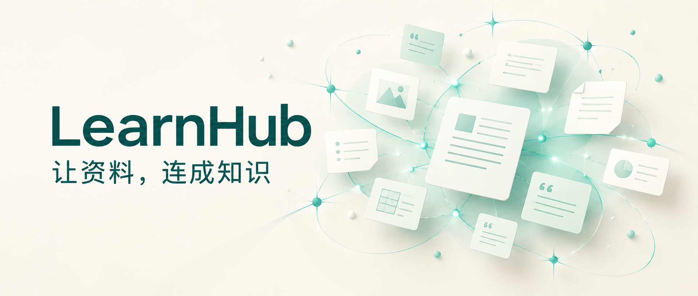
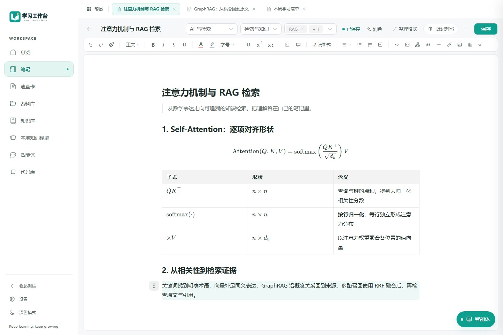
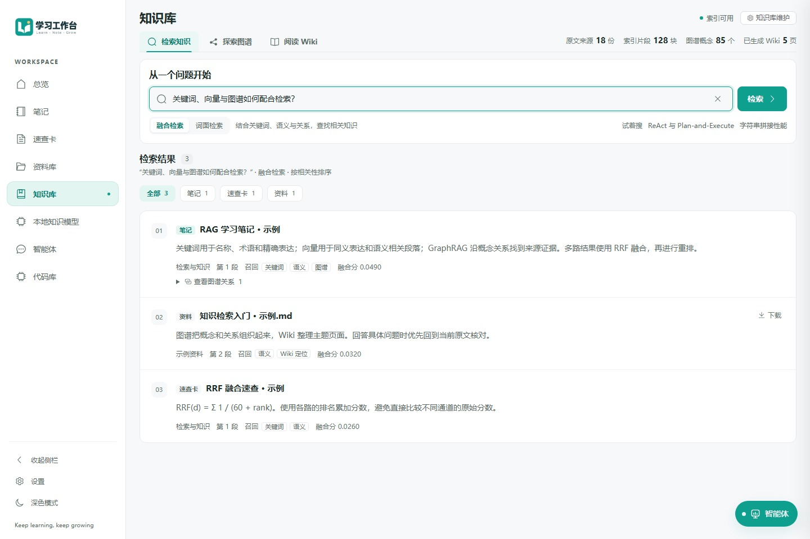

# 别让资料停在收藏夹：认识一下 LearnHub

> 把资料、笔记和 AI，连成自己的知识网络。



你可能也有过这样的时刻。

看到一篇好文章，先收藏；下载一份 PDF，放进文件夹；遇到一个新概念，再打开 AI 问一问。过了一段时间，资料越来越多，真正需要的时候，却记不起答案藏在哪里。

找到资料之后，还有下一道难题：读过的内容，怎样和已有知识联系起来？AI 给出的解释，能不能回到原文核对？这一次的理解，又该怎样留给下一次使用？

**LearnHub，就是围绕这些问题搭建的学习工作台。**

它是一个可自托管的学习与知识管理项目，把笔记、原始资料、速查卡、代码片段和智能体放在同一个空间里，让学习沿着一条清晰的路径继续：

**收纳资料 → 检索并核对原文 → 探索知识关联 → 整理成自己的笔记。**

## 01 先有一个，能认真写笔记的地方

学习经常需要同时打开几篇笔记：一篇记概念，一篇放推导，另一篇整理自己的疑问。

LearnHub 支持多笔记标签页、Markdown 与块编辑，也能呈现表格、代码和 LaTeX 数学公式。切换笔记时，会保留当前页面里的草稿、光标和撤销记录，方便在不同思路之间来回对照；刷新或退出前，记得先保存。

笔记和资料库都采用熟悉的目录浏览方式：顶部看路径，列表里同时查看子文件夹和内容。随着一个主题越学越深，可以逐渐整理目录，也可以通过“全部”入口跨目录浏览。

**先把想法写下来，再慢慢建立结构。**



*图 1｜从一篇笔记开始，把文字、公式、表格和自己的思考放在一起。*

## 02 重新找到答案，也重新找到出处

当资料积累起来，搜索就不只是输入一个文件名。

有时你记得一个准确术语，有时只记得大概意思，还有时需要找出两个概念之间的联系。

LearnHub 将关键词、向量、图谱和 Wiki 导览结合起来：关键词帮助定位明确表达，向量检索寻找措辞不同但语义接近的片段，图谱与 Wiki 则提供进一步阅读的方向。

搜索结果里，可以查看命中片段、召回通道和原文入口。找到相关结论后，还能继续回到来源，确认它讨论的条件、上下文和适用范围。

资料阅读也在这个工作台里完成。PDF、Word 和 Markdown 可以直接阅读，遇到外文段落，还能选段进行对照翻译。

**答案有用，能找到答案从哪里来，同样有用。**



*图 2｜从一个问题出发，找到相关片段，再回到原文核对。*

## 03 让零散知识，慢慢连成一张网

读完几篇同一主题的资料之后，新的问题往往是：它们之间有什么关系？还有哪些概念没有弄明白？

LearnHub 提供两种互相配合的入口。

**社区星图，让你先看到知识的分布。** 从一个主题社区进入，可以继续展开具体概念及其关系，沿着有来源的联系回查资料。它适合用来探索学习方向，也适合在一个主题学到一半时，重新梳理整体结构。


*图 3｜先看主题分布，再进入一个社区，继续探索概念之间的联系。*

**LLM Wiki，则把分散内容组织成可连续阅读的页面。** 主题页、概念页和索引页通过双链连接，保留引用与来源依赖，方便从一个问题读到另一个问题。

当原始资料发生变化，相关 Wiki 会显示待更新状态，受影响的检索导览会停用，后台再按需更新。索引、图谱与社区也有对应的维护流程，可以查看执行进度和重试状态。

这些结构提供了阅读线索。对关键结论，依然可以沿着引用回到原文，继续核对。


*图 4｜把资料整理成有联系的主题页面，并保留回到来源的入口。*

## 04 让 AI 参与学习，整理结果由你确认

LearnHub 里的智能体，可以结合笔记和资料开展工作：检索相关内容、读取来源、梳理问题，或者帮助修改一篇已有笔记。

例如，在学习检索增强生成时，可以提出这样的需求：

> 帮我查找资料中关于关键词检索与向量检索的说明，比较它们各自适合的场景，给出原文依据，再整理成一段适合放进学习笔记的内容。

这个例子描述的是一种使用方式。实际结果会受到资料内容、模型和检索配置的影响。

执行过程中，你可以查看智能体的计划、检索和工具调用。涉及笔记写入时，会先看到修改预览，确认后再落到笔记中。

**让 AI 帮忙查找与整理，把核对和取舍留在学习过程里。**


*图 5｜从提问到整理，查看智能体的处理步骤，写入笔记前先确认。*

## 05 从一份资料开始，走完一次学习流程

不必一开始就搭建庞大的知识库。可以先选一个正在学习的主题，放入几份资料：

1. **收纳。** 导入 PDF、Word、Excel、PPT 或文本，按主题整理。
2. **阅读。** 用阅读器打开 PDF、Word 或 Markdown 原文，把不明白的概念记下来。
3. **追问。** 检索相关片段，核对出处，再从 Wiki 和星图补齐关联。
4. **沉淀。** 将确认后的理解写进笔记，把常用命令、API 或操作步骤整理为速查卡。

如果平时还会阅读代码，也可以按项目与语言整理代码片段，再通过自然语言搜索寻找实现，并查看返回的行号依据。

学习的成果，可以是一篇逐渐完善的笔记、一张经常用到的速查卡，也可以是一条下次还能找到的原文线索。

## 06 想体验，可以从基础功能开始

LearnHub 支持自行部署。按照项目当前文档，准备 Node.js 22.14+、正在运行的 Docker，以及 Docker Compose 2.20+ 后，可以使用启动器：

```bash
npx @luyiyanyumu/learnhub@latest start
```

默认访问地址是 `http://localhost:8888`。安装、模型配置和更新方式，可在项目仓库中查看。

没有配置模型，也可以先使用笔记、资料管理和关键词检索。智能体、Wiki 生成、翻译等功能需要配置相应模型；语义检索需要嵌入档案。模型与联网工具的数据流向，取决于你选择的服务。

项目采用 **PolyForm Noncommercial 1.0.0** 许可证。非商业使用与分发应遵守许可条款，商业使用需另行获得授权。

**项目仓库：** [github.com/luyiyanyumu/LearnHub](https://github.com/luyiyanyumu/LearnHub)

如果你也希望把零散资料组织成可以持续积累的学习空间，欢迎了解 LearnHub。可以从手头正在读的那份资料开始，慢慢搭起自己的知识网络。

*配图说明：封面为 AI 生成的概念插画；正文界面截图来自项目的独立合成演示数据。图中内容、数量、回答与耗时仅作功能展示，不代表真实知识库或模型效果。*
